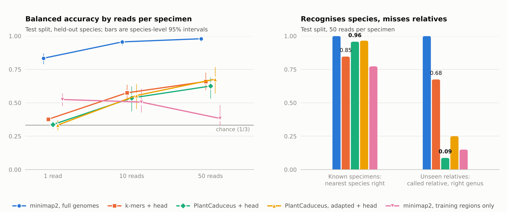
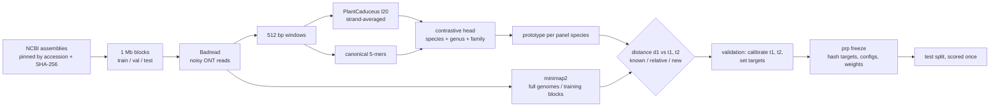

<div align="center">

# plant-read-placement

**Can a plant DNA language model identify a plant from a handful of noisy Nanopore reads?**

A preregistered benchmark of [PlantCaduceus](https://doi.org/10.1073/pnas.2421738122) against k-mer
composition and minimap2, on real plant genomes and species the models never saw.

[](https://github.com/gbadedata/plant-read-placement/actions/workflows/tests.yml)

[](LICENSE)
[](PREREG.md)
[](TEST_RUN.json)

[Results](#results) · [How it works](#how-it-works) · [Audit trail](#audit-trail) ·
[What went wrong](#what-went-wrong-and-what-it-taught) · [Reproduce](#reproduce) · [Full write-up](results/SUMMARY.md)

</div>

> [!IMPORTANT]
> **Short answer: not yet.** With a trained contrastive head, PlantCaduceus placed specimens slightly
> worse than plain 5-mer composition (balanced accuracy 0.54 against 0.58 at 10 reads per specimen).
> Alignment to full reference genomes reached 0.96. The language model is better at *recognising*
> known species (right species for 96% of known specimens at 50 reads, against 85% for k-mers). Where it
> fails is the *"nearest relative"* call on species it has never seen. One of six preregistered
> targets was met.

<picture>
  <source media="(prefers-color-scheme: dark)" srcset="docs/figures/results-dark.png">
  
</picture>

## The question

Most of the world's plant species have never been sequenced. A specimen read in the field on a
portable Oxford Nanopore device yields a few low-coverage, error-prone long reads. The useful question
is not "which genome does this read align to?" but a placement decision:

| Call | Meaning | Counts as correct when |
|---|---|---|
| **known species** | one of the species in the reference panel | the species is right |
| **nearest relative** | not a panel species, but its genus is in the panel | the genus is right |
| **likely new** | nothing in the panel is close enough to say more | it is called new |

This repository adapts **PlantCaduceus** (Zhai et al., *PNAS* 2025), a DNA language model pre-trained on
16 angiosperm genomes, to that decision. It benchmarks the model against an alignment-free **k-mer**
baseline and against **minimap2**, with every target written down and frozen in code before the test
split was scored.

## Results

One preregistered run on the test split, held-out species only, no deviations
([`results/test/RESULTS.md`](results/test/RESULTS.md), [`TEST_RUN.json`](TEST_RUN.json)). Balanced
accuracy over the three calls, with 95% intervals that resample species:

| Method | 1 read | 10 reads | 50 reads |
|---|---|---|---|
| minimap2, full panel genomes | 0.834 [0.790, 0.872] | **0.956** [0.930, 0.975] | 0.980 [0.957, 0.995] |
| k-mer composition + contrastive head | 0.377 [0.357, 0.397] | 0.575 [0.513, 0.637] | 0.659 [0.595, 0.727] |
| PlantCaduceus, top layers adapted + head | 0.333 [0.294, 0.372] | 0.554 [0.454, 0.640] | 0.677 [0.570, 0.769] |
| PlantCaduceus + head | 0.337 [0.308, 0.364] | 0.536 [0.437, 0.622] | 0.626 [0.532, 0.691] |
| minimap2, training regions only | 0.525 [0.476, 0.572] | 0.506 [0.430, 0.608] | 0.383 [0.333, 0.483] |
| PlantCaduceus embeddings, no head | 0.333 | 0.332 | 0.428 |

Chance is 1/3.

### The six preregistered hypotheses

Targets were set from the validation run and frozen before the test ([`PREREG.md`](PREREG.md), section 6).
A hypothesis is met only if the test point estimate reaches its target.

| | Hypothesis (10 reads per specimen) | Validation | Target | Test | Met |
|---|---|---|---|---|:-:|
| H1 | PlantCaduceus + head, balanced accuracy | 0.588 | ≥ 0.538 | 0.536 | ✗ |
| H2 | PlantCaduceus minus k-mers ("does the language model add anything?") | +0.004 | ≥ +0.020 | −0.039 | ✗ *predicted* |
| H3 | New-species detection, AUROC | 0.921 | ≥ 0.871 | 0.891 | ✓ |
| H4 | Relatives placed nearest the right genus | 0.973 | ≥ 0.923 | 0.920 | ✗ |
| H5 | Adapted minus frozen PlantCaduceus | +0.011 | ≥ +0.020 | +0.018 | ✗ *predicted* |
| H6 | minimap2's lead over PlantCaduceus | +0.325 | ≤ +0.375 | +0.420 | ✗ |

H2 and H5 were predicted in writing, before the test, not to be met. H1, H4 and H5 missed by 0.003 or less.
That is well inside their intervals, but the rule was the point estimate, so they are reported as missed.

### What the results say

1. **The language model did not beat composition.** k-mers also held up better from validation to test
   (0.584 to 0.575, against 0.588 to 0.536). Without a head, PlantCaduceus embeddings place specimens
   at chance, so all of the useful signal comes through the trained head.
2. **It recognises species well.** Ignoring the decision thresholds, the nearest prototype is the
   right species for 0.96 of known specimens at 50 reads, against 0.85 for k-mers.
3. **The "relative" call is where it breaks.**
   - It puts unseen relatives next to the right genus (0.96), but the distance band that marks "relative" does not transfer from the validation species to new species.
   - On validation, most relatives fell inside the "known" threshold; on test, most fell beyond the "new" one.
   - Relatives and new species overlap in its distance scale (AUROC 0.80, against 0.96 for k-mers).
4. **Alignment wins because it has seen the sequence.**
   - Restricted to the training regions, minimap2 recognises species from unseen parts of a genome less often than either learned method (0.77 against 0.85 to 0.97).
   - It also never calls "known" correctly, because those reads only hit repeats elsewhere in their own genome.
5. **Adapting the top four layers helped a little, uncertainly:** +0.018 at 10 reads (just under the
   bar) and +0.051 at 50 reads, with overlapping intervals.

Points 2 to 4 come from an exploratory breakdown (`prp explore`) and are labelled that way in
[`results/SUMMARY.md`](results/SUMMARY.md). The obvious next step is a decision rule that uses more than
the distance to the nearest prototype, tested on real Nanopore reads.

## How it works



- **Reads:** 80,000 reads simulated with Badread (Nanopore 2023 error model, median identity 92.5%,
  mean length 8 kb) from real NCBI assemblies.
- **Embedding a read:** each read is cut into up to eight evenly spaced 512 bp windows. PlantCaduceus
  embeds each window on both strands, and the window embeddings are averaged.
- **Training:** a small projection head (two hidden layers of 512) is trained with a hierarchical supervised contrastive loss
  (species, plus genus at 0.5 and family at 0.25).
- **Placing a specimen:** a specimen of 1, 10 or 50 reads is placed by its distance to the nearest
  panel-species prototype. The thresholds t1 and t2 are calibrated on validation species only.

### Design decisions that matter

| Risk | Control |
|---|---|
| Test reads overlapping training sequence | Panel genomes are cut into 1 Mb blocks; each block goes to exactly one split by a seeded hash, ranked so every split is non-empty. |
| Soft-masked repeats leaking into reads | Assemblies are upper-cased before simulation; real reads carry no repeat annotation. |
| Held-out species seen in pre-training | PlantCaduceus was pre-trained on 8 Poaceae and 8 Brassicales genomes. No species here comes from either clade, and `prp check-panel --strict` refuses an unconfirmed one. |
| Strand of a read changing its embedding | k-mers are canonicalised. PlantCaduceus's forward and reverse-complement channels are aligned and averaged, and both are unit-tested for exact reverse-complement invariance. |
| Thresholds or models tuned on the test set | Thresholds, model selection and targets use validation species only. `prp freeze` hashes the plan, configs, thresholds and weights. `prp evaluate --split test` refuses to run without the lock or if a frozen file changed, checks every input before it registers the run, and logs any re-run as a deviation. |
| Over-confident intervals | Specimens from one species are correlated, so 95% intervals resample *species* within each truth class. |
| A weak baseline | `minimap2` indexes the *full* genome of every panel species, test regions included, which favours it and is stated in advance. `minimap2_train` indexes only the training blocks, like-for-like with the learned methods. Both are reported. |
| "Likely new" judged leniently | A call is correct only end to end: known needs the right species, relative the right genus. |

Two properties of the model shape the experiment:
- **A domain shift.** PlantCaduceus was pre-trained mostly on gene windows, with repeats down-weighted.
  Low-coverage whole-genome reads are dominated by repeats and intergenic sequence.
- **A short context.** The model sees 512 bp, so each long read is summarised by averaging windows.
  PlantCAD2, with an 8,192 bp context, is a drop-in option in `configs/experiment.yaml`.

### Panel

28 species from 12 orders, none from the pre-training clades ([`configs/panel.yaml`](configs/panel.yaml)):

| Role | Species | Truth |
|---|---|---|
| panel (13) | *Solanum lycopersicum*, *S. melongena*, *Coffea canephora*, *Catharanthus roseus*, *Medicago truncatula*, *Phaseolus vulgaris*, *Prunus persica*, *P. avium*, *Cucumis sativus*, *Citrus × clementina*, *C. maxima*, *Populus trichocarpa*, *Vitis vinifera* | known |
| validation (6) | *Solanum pennellii*, *Prunus mume*, *Citrus sinensis*; *Theobroma cacao*, *Malus domestica*, *Ricinus communis* | relative; new |
| test (9) | *Solanum tuberosum*, *Coffea eugenioides*, *Cucumis melo*, *Phaseolus lunatus*; *Beta vulgaris*, *Sesamum indicum*, *Aquilegia coerulea*, *Citrullus lanatus*, *Fragaria vesca* | relative; new |

- **The Madagascar periwinkle.** *Catharanthus roseus*, source of the vinca alkaloids, is in the panel.
- **The hardest case.** Three of the "new" species (*Malus*, *Citrullus*, *Fragaria*) belong to panel
  families but new genera.

### Methods compared

| Method | Read representation | Placement |
|---|---|---|
| `plantcad_head` (primary) | PlantCaduceus l20, frozen | contrastive head + prototypes |
| `plantcad_ft2_head` | PlantCaduceus with the top four Mamba blocks and final norm adapted on noisy windows | contrastive head + prototypes |
| `plantcad_raw` | PlantCaduceus, frozen | raw embeddings + prototypes |
| `kmer_head`, `kmer_raw` | canonical 5-mer composition | head or raw, as above |
| `minimap2` | alignment to full panel genomes | 1 - matched-base fraction as distance |
| `minimap2_train` | alignment to training blocks only | as above |

All methods go through the same specimen builder, decision rule and calibration. `plantcad_ft_head`, the
first adaptation attempt, is kept as a validation record only (see below).

## Audit trail

The order of events is public, from GitHub's push log:

| When (19 Nov 2026, UTC) | What | Commit |
|---|---|---|
| 02:12:50 | targets set from validation, rule written above the table | [`9b25b49`](https://github.com/gbadedata/plant-read-placement/commit/9b25b49) |
| 02:14:31 | `prereg.lock.json` pushed: hashes of the plan, configs, thresholds, weights and genome lock | [`5f83686`](https://github.com/gbadedata/plant-read-placement/commit/5f83686) |
| 02:14:50 | test split first scored (`TEST_RUN.json`) | |
| 02:28:38 | test results pushed, unedited | [`30fbd97`](https://github.com/gbadedata/plant-read-placement/commit/30fbd97) |

Check that the committed plan has not changed since the freeze:

```bash
python - <<'EOF'
import hashlib, json
lock = json.load(open("prereg.lock.json"))
for f in ["PREREG.md", "configs/panel.yaml", "configs/experiment.yaml"]:
    same = hashlib.sha256(open(f, "rb").read()).hexdigest() == lock["files"][f]
    print(f, "matches the freeze" if same else "CHANGED since the freeze")
EOF
```

Every change made on validation before the freeze is listed in the development log in
[`PREREG.md`](PREREG.md), section 9.

## What went wrong, and what it taught

- **Strand averaging was wrong at first.**
  - Caduceus models store the reverse-complement half of their hidden state flipped along both the
    sequence and the channel axes. The first version flipped only the sequence.
  - A fake model that mirrors the real output layout now tests this, and `prp gpu-check` confirms
    strand invariance on the real model before any long run (minimum cosine 0.9999998).
- **The first fine-tune ran out of GPU memory on a 16 GB T4.** 208 windows per step, each
  backpropagated through four reverse-complement-equivariant Mamba blocks, needed more than the T4's
  14.5 GiB. The step
  was shrunk, and a logged fallback now halves the batch instead of crashing.
- **The first fine-tune then collapsed.**
  - The species, genus and family loss terms all sat at ln 51 = 3.93 for 3,000 steps. That is the value
    this loss takes when every pair in a 52-read batch looks equally similar: the head had stopped
    separating anything.
  - The diagnosis, and the prediction that a retry would end similarly, were written into
    [`PREREG.md`](PREREG.md) before the retry finished.
  - The one pre-committed retry (3 windows per read, 5x learning rate) escaped the collapse only
    partly. A design flaw found along the way: the fine-tune head scaled its inputs from the first 128
    training windows only, while PlantCaduceus read embeddings are extremely anisotropic (median cosine
    0.998 between two random reads; 99% of the variance in 5 of 384 directions).
- **It is reproducible.** Frozen embeddings re-made in a second Kaggle session matched the first
  bit for bit.

## Reproduce

```bash
pip install torch --index-url https://download.pytorch.org/whl/cpu
pip install -e ".[dev]" && pip install git+https://github.com/rrwick/Badread.git
pytest                                    # 42 tests, about a minute
prp toy --out toy && cd toy && prp run-toy --panel configs/panel.yaml --config configs/experiment.yaml
```

The toy run exercises every stage, including the freeze and the locked test run, on synthetic genomes.
Its numbers mean nothing about real plants.

The real run is in [`docs/RUNBOOK.md`](docs/RUNBOOK.md):

| Stage | Where | Time |
|---|---|---|
| fetch, split, simulate, window | any Linux machine (a laptop under WSL was used) | overnight |
| k-mer features, minimap2 (both indexes) | laptop | 1-3 h |
| PlantCaduceus embeddings | free Kaggle notebook, 2 x T4 ([`kaggle/plantcad_gpu.ipynb`](kaggle/plantcad_gpu.ipynb)) | about 80 min per encoder |
| fine-tuning, top four layers | Kaggle, one T4 | 77 min (1 window per read) to 4.7 h (3 windows) |
| heads, calibration, freeze, test | laptop | minutes |

- **The Kaggle environment.** The notebook rebuilds the authors' pinned environment (torch 2.5.1,
  mamba-ssm 2.2.4) in an isolated Python 3.11. It runs `prp gpu-check` before anything long, which
  checks token ids, strand invariance, fp16 agreement and layer names.
- **The figure.** `python scripts/make_readme_figure.py` redraws the figure above from
  `results/test/metrics.json`.

## Limitations

- **Simulated reads.** The reads come from one simulator. Real field data (degraded DNA, contamination,
  non-plant reads) will be harder, and a check on real Nanopore reads is the first thing to add.
- **Wide intervals.** There are few held-out species per class (4 to 13), and most differences between
  the learned methods sit inside the intervals.
- **Thresholds tuned on validation species.** That they transfer poorly to new species is one of the findings.
- **Short reads, as the model sees them.** It sees 512 bp windows of long reads.
- **Out of scope.** Flagging alkaloid-biosynthesis genes is not attempted here.

## Repository layout

```
configs/      panel.yaml (species and roles), experiment.yaml (every setting)
src/prp/      genomes, regions, simulate, windows, encoders, embed, losses, heads, train,
              placement, minimap, metrics, prereg, report, toy, gpucheck, cli
tests/        42 tests, including a fake model with Caduceus's exact output layout and the full toy pipeline
kaggle/       GPU notebook for the PlantCaduceus steps
scripts/      environment setup, Kaggle packing, retry import, README figure
docs/         RUNBOOK.md, figures/
results/      SUMMARY.md and the frozen test results (test/)
PREREG.md     hypotheses, targets and development log, frozen before the test run
prereg.lock.json, TEST_RUN.json    the freeze and the record of the single test run
```

## Citation

If you use this benchmark, cite it with the metadata in [`CITATION.cff`](CITATION.cff) (GitHub's
"Cite this repository" button reads it).

## References

- Zhai J, Gokaslan A, Schiff Y, et al. Cross-species modeling of plant genomes at single-nucleotide
  resolution using a pretrained DNA language model. *PNAS* 122(24):e2421738122 (2025).
  doi:10.1073/pnas.2421738122
- Schiff Y, Kao C-H, Gokaslan A, Dao T, Gu A, Kuleshov V. Caduceus: bi-directional equivariant
  long-range DNA sequence modeling. *ICML* (2024). arXiv:2403.03234
- Wick RR. Badread: simulation of error-prone long reads. *JOSS* 4(36):1316 (2019).
  doi:10.21105/joss.01316
- Li H. Minimap2: pairwise alignment for nucleotide sequences. *Bioinformatics* 34(18):3094-3100
  (2018). doi:10.1093/bioinformatics/bty191
- Khosla P, Teterwak P, Wang C, et al. Supervised contrastive learning. *NeurIPS* (2020).
  arXiv:2004.11362

## License

[MIT](LICENSE). Genome assemblies are fetched from NCBI under their own terms and are not redistributed here.
