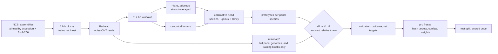

# plant-read-placement

[](https://github.com/gbadedata/plant-read-placement/actions/workflows/tests.yml)

**Can a plant DNA language model tell you what a plant is from a handful of noisy Nanopore reads,
when no reference genome exists for that plant?**

Most of the world's plant species have never been sequenced. A specimen sequenced in the field on a
portable Oxford Nanopore device yields low-coverage, error-prone long reads. The useful question is
not "which genome does this read align to?" but a placement decision:

- **known species**: it is one of the species in the reference panel, and which one;
- **nearest relative**: it is not a panel species, but its genus is in the panel, and which genus;
- **likely new**: nothing in the panel is close enough to say more.

This repository adapts **PlantCaduceus** (Zhai et al., PNAS 2025), a DNA language model pre-trained
on 16 angiosperm genomes, to that task. It trains a contrastive head, optionally adapts the top
backbone layers on noisy reads, and benchmarks the result against **minimap2** and an alignment-free
**k-mer** baseline on held-out genomes. The targets are written down and frozen in code before the
test split is ever scored.

## Pipeline



## Design decisions that matter

| Risk | Control |
|---|---|
| Test reads overlapping training sequence | Panel genomes are cut into 1 Mb blocks; each block goes to exactly one split by a seeded hash, ranked so every split is non-empty. |
| Soft-masked repeats leaking into reads | Assemblies are upper-cased before simulation; real reads carry no repeat annotation. |
| Held-out species seen in pre-training | PlantCaduceus was pre-trained on 8 Poaceae and 8 Brassicales genomes; no held-out species comes from either clade, and `prp check-panel --strict` refuses an unconfirmed one. |
| Strand of a read changing its embedding | k-mers are canonicalised; PlantCaduceus's forward and reverse-complement channels are aligned and averaged. Both are unit-tested for exact reverse-complement invariance. |
| Thresholds or models tuned on the test set | Thresholds, model selection and targets use validation species only. `prp freeze` hashes PREREG.md, configs, thresholds and weights; `prp evaluate --split test` refuses to run without the lock, refuses if a frozen file changed, and logs any re-run as a deviation. |
| Over-confident intervals | Specimens from one species are correlated, so 95% intervals resample *species* within each truth class. |
| A weak baseline | `minimap2` indexes the *full* genome of every panel species, test regions included, which favours it on known species; that is realistic for a reference database and stated in advance. `minimap2_train` indexes only the training blocks, like-for-like with the learned methods. Both are reported. |
| "Likely new" judged leniently | A call is correct only end to end: known needs the right species, relative needs the right genus. |

Two things about the model shape the experiment. PlantCaduceus was pre-trained mostly on gene
(CDS) windows with repeats down-weighted, while low-coverage whole-genome reads from plants are
dominated by repeats and intergenic sequence, so adapting it to reads is a real domain shift. And its
context is 512 bp, so each long read is summarised by averaging up to eight evenly spaced windows;
PlantCAD2 (8,192 bp context) is a drop-in option in `configs/experiment.yaml`.

## Panel

28 species from 12 orders, none from the pre-training clades (`configs/panel.yaml`):

| role | species | truth |
|---|---|---|
| panel (13) | *Solanum lycopersicum*, *S. melongena*, *Coffea canephora*, *Catharanthus roseus*, *Medicago truncatula*, *Phaseolus vulgaris*, *Prunus persica*, *P. avium*, *Cucumis sativus*, *Citrus × clementina*, *C. maxima*, *Populus trichocarpa*, *Vitis vinifera* | known |
| validation (6) | *Solanum pennellii*, *Prunus mume*, *Citrus sinensis*; *Theobroma cacao*, *Malus domestica*, *Ricinus communis* | relative; new |
| test (9) | *Solanum tuberosum*, *Coffea eugenioides*, *Cucumis melo*, *Phaseolus lunatus*; *Beta vulgaris*, *Sesamum indicum*, *Aquilegia coerulea*, *Citrullus lanatus*, *Fragaria vesca* | relative; new |

*Catharanthus roseus*, the Madagascar periwinkle, is in the panel. Three of the "new" species
(*Malus*, *Citrullus*, *Fragaria*) belong to panel families but new genera: the hardest case.

## Methods compared

`plantcad_head` (primary), `plantcad_ft2_head` (backbone adapted on noisy windows; attempt 1,
`plantcad_ft_head`, did not adapt and is kept as a record), `plantcad_raw`,
`kmer_head`, `kmer_raw`, `minimap2` (full panel genomes) and `minimap2_train` (training blocks only, like-for-like
with the learned methods), all through the same specimen builder, decision rule and
calibration. Specimens of 1, 10 and 50 reads. Full definitions in [PREREG.md](PREREG.md).

## Quick start

```bash
pip install torch --index-url https://download.pytorch.org/whl/cpu
pip install -e ".[dev]" && pip install git+https://github.com/rrwick/Badread.git
pytest                                    # 36 tests, about a minute
prp toy --out toy && cd toy && prp run-toy --panel configs/panel.yaml --config configs/experiment.yaml
```

The toy run exercises every stage, freeze and the locked test run on synthetic genomes. Its numbers
mean nothing about real plants. The real run is in [docs/RUNBOOK.md](docs/RUNBOOK.md): CPU stages on
any Linux machine, and the PlantCaduceus steps in a free Kaggle GPU notebook
([kaggle/plantcad_gpu.ipynb](kaggle/plantcad_gpu.ipynb)) that rebuilds the authors' pinned environment
and runs a pre-flight check (`prp gpu-check`) before anything long.

## Results

One preregistered test run on held-out species, no deviations. Targets, freeze and results were
pushed in that order (19 Nov 2026, 02:12, 02:14 and 02:28 UTC). The full write-up is in
[`results/SUMMARY.md`](results/SUMMARY.md).

| Test split, 10 reads per specimen | Balanced accuracy [95% CI] |
|---|---|
| minimap2, full panel genomes | 0.956 [0.930, 0.975] |
| k-mer composition + contrastive head | 0.575 [0.513, 0.637] |
| PlantCaduceus, top layers adapted + head | 0.554 [0.454, 0.640] |
| PlantCaduceus + head | 0.536 [0.437, 0.622] |
| minimap2, training regions only | 0.506 [0.430, 0.608] |

- **1 of 6 preregistered targets met** (detecting new species, AUROC 0.891). The language model did
  not beat 5-mer composition, and both are far behind alignment to full reference genomes.
- **The language model's strength is recognising species.** At 50 reads the nearest prototype is
  the right species for 0.96 of known specimens, against 0.85 for k-mers and 0.77 for alignment to the
  training regions only.
- **Its weakness is the "relative" call.** Distance thresholds set on the validation species do not
  transfer to new species.

## Limitations

Reads are simulated with one simulator, so real field data (degraded DNA, contamination, non-plant
reads) will be harder. There are few held-out species per class, so intervals are wide. The model
sees 512 bp windows of long reads. The brief's second task, flagging alkaloid-biosynthesis genes, is
not attempted here.

## Repository layout

```
configs/      panel.yaml (species, roles), experiment.yaml (every setting)
src/prp/      genomes, regions, simulate, windows, encoders, embed, losses, heads, train,
              placement, minimap, metrics, prereg, report, toy, cli
tests/        unit tests (including a fake model with Caduceus's exact output layout) + full toy pipeline
kaggle/       GPU notebook for the PlantCaduceus steps
scripts/      environment setup (laptop, GPU, Kaggle) and upload packing
docs/         RUNBOOK.md
PREREG.md     hypotheses and targets, frozen before the test run
```

## References

- Zhai J, Gokaslan A, Schiff Y, et al. Cross-species modeling of plant genomes at single-nucleotide
  resolution using a pretrained DNA language model. *PNAS* 122(24):e2421738122 (2025).
  doi:10.1073/pnas.2421738122
- Schiff Y, Kao C-H, Gokaslan A, Dao T, Gu A, Kuleshov V. Caduceus: bi-directional equivariant
  long-range DNA sequence modeling. *ICML* (2024). arXiv:2403.03234
- Wick RR. Badread: simulation of error-prone long reads. *JOSS* 4(36):1316 (2019).
  doi:10.21105/joss.01316
- Li H. Minimap2: pairwise alignment for nucleotide sequences. *Bioinformatics* 34(18):3094-3100
  (2018). doi:10.1093/bioinformatics/bty191
- Khosla P, Teterwak P, Wang C, et al. Supervised contrastive learning. *NeurIPS* (2020).
  arXiv:2004.11362
